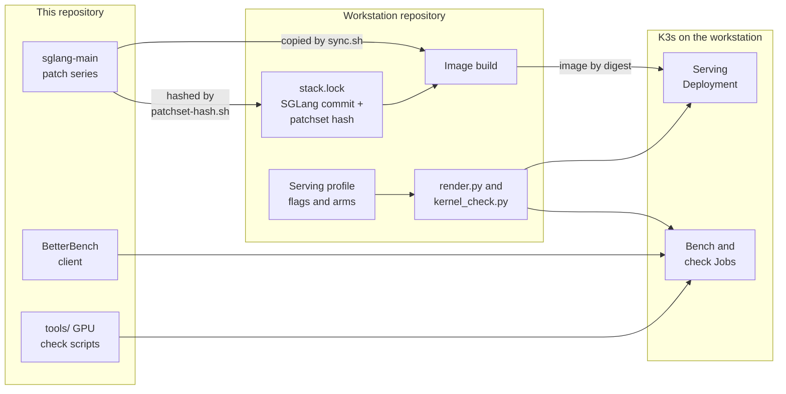
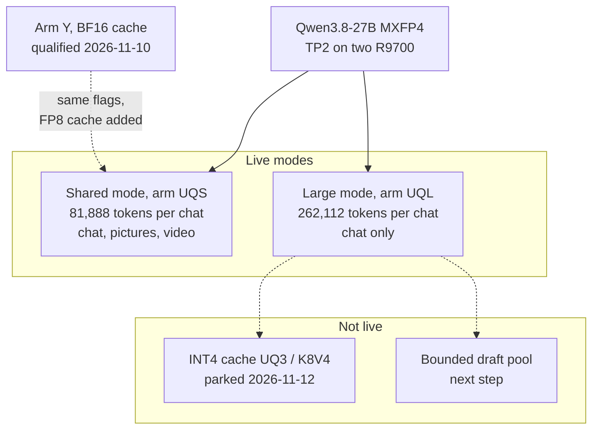

# Spry.ai RDNA4 Serving

This repository makes Qwen3.8-27B run fast on two AMD Radeon AI PRO R9700 GPUs.
It holds the SGLang patches, benchmark client, GPU check tools and research
records behind the family assistant's chat model.

It does not deploy anything. The workstation repository,
[ArchLinuxThreadripper](https://github.com/Drgr33nSenior/ArchLinuxThreadripper),
builds the serving image from these patches and runs it on K3s.

## How the two repositories fit together

The workstation pins this repository's patch series by a content hash, not by a
commit. It also reads the benchmark client and two GPU check tools from a local
checkout of this repository.



| This repository provides | The workstation uses it in |
| --- | --- |
| [`serving/patches/sglang-main/`](serving/patches/sglang-main/README.md) | `refresh.sh`, `sync.sh` and the SGLang build stage |
| [`benchmarks/betterbench/native-v2/`](benchmarks/betterbench/native-v2/README.md) | `render.py bench`, the throughput bench Job |
| `tools/check_fp8_kv_dequant.py`, `tools/bench_int4_kv.py` | `kernel_check.py`, single-GPU kernel check Jobs |

## What runs today

Checked on 12 November 2026. The flags and versions live in the workstation's
[serving profile](https://github.com/Drgr33nSenior/ArchLinuxThreadripper/blob/main/infrastructure/ai-stack/serving/qwen3.8-27b-mxfp4-tp2.json)
and [`stack.lock`](https://github.com/Drgr33nSenior/ArchLinuxThreadripper/blob/main/infrastructure/ai-stack/stack.lock).

| Part | What is used |
| --- | --- |
| Model | Qwen3.8-27B with MXFP4 weights, plus a DFlash2 draft model for speculative decoding |
| Server | SGLang `main` at `fcb32746` (0.5.23.post957) with this repository's 27-patch series (patchset hash `142d0ae7…`) |
| Libraries | PyTorch 2.16.0a0 nightly built for ROCm 10.3.0-dev (2026-11-08), HIP 7.18 |
| Hardware | Two R9700 cards, each capped at 235 W; tensor parallel across both (TP2) |
| Attention cache | FP8, read back as bf16 by patches 0026 and 0027 |

The workstation runs the model in one of two modes. Each mode uses one
qualified profile arm (a named set of flags).



| Arm | Mode | Context per conversation | Cache pool | Measured |
| --- | --- | --- | --- | --- |
| UQS | Shared (default) | 81,888 tokens | 163,840 tokens | BetterBench 135.1 tok/s at one request, 224.8 at two (2026-11-11) |
| UQL | Large | 262,112 tokens | 524,288 tokens | BetterBench 133.8 / 229.9 tok/s (2026-11-11) |
| Y | None (previous default) | 131,040 tokens | 262,144 tokens, BF16 | BetterBench median 139.2 / 254.7 tok/s (2026-11-10) |

A single interactive chat probe on the live service measured about 86 tok/s on
12 November 2026. BetterBench is a throughput benchmark; quality is checked
separately by the workstation's quality menu. The workstation
[modes guide](https://github.com/Drgr33nSenior/ArchLinuxThreadripper/blob/main/docs/MODES.md)
explains what each mode runs on each card.

## Research status

| Topic | State | Record |
| --- | --- | --- |
| FP8 attention cache (UQ2) | Live in UQS and UQL | [Patch series](serving/patches/sglang-main/README.md), patches 0026 and 0027 |
| INT4 attention cache (UQ3, K8V4) | Parked: 1.6–2.3x slower verify attention than FP8, with worse accuracy | [INT4 verify-kernel record](docs/UQ3-INT4-VERIFY-KERNEL-20261112.md) |
| Bounded DFlash draft pool | Next: follow upstream SGLang [#47058](https://github.com/sgl-project/sglang/issues/47058) | Earlier plan: [draft-pool plan](docs/DFLASH-BOUNDED-DRAFT-POOL-PLAN-20261111.md) |

## Repository map

| Directory | Contents | Status |
| --- | --- | --- |
| `serving/patches/sglang-main/` | The live SGLang patch series | Current |
| `benchmarks/betterbench/` | BetterBench v0.6.1 client and profile | Current (used by the bench Job) |
| `tools/` | GPU check and benchmark scripts | Mixed: the KV-cache scripts (`check_fp8_kv_dequant.py`, `bench_int4_kv.py`, `uq3_*.py`) are recent; the rest served the old runtime |
| `tests/`, `Makefile` | CPU tests for tools and historical source | Current |
| `docs/` | Guides plus dated research records | See the [documentation guide](docs/README.md) |
| `serving/` (other than the patches) | Cleanup source for the SGLang 0.5.21 runtime | Historical |
| `prototype/`, `common-runtime/`, `patches/` | KV4 cache prototype and 0.5.21 repairs | Historical |
| `profiles/`, `provenance/` | Recorded profiles, hashes, selections and result summaries | Historical, sealed |
| `.agents/` | Agent skill for the evidence workflow | Mostly historical |

## Run the local checks

The CPU tests need Python 3.14 and a C++17 compiler. They do not load a model
or use a GPU.

```sh
make test PYTHON=python3.14 CXX=clang++
```

[VERIFICATION](docs/VERIFICATION.md) lists the focused targets, including the
patch-series and INT4 tool checks.

## History

From October to early November 2026 this project ran on SGLang 0.5.21, first
with FP8 weights and then with MXFP4 weights. That work ended with an owner
selection called "op234" on 7 November 2026. The November workstation reinstall
then wiped the 0.5.21 runtime. Serving moved to SGLang `main` with the
`sglang-main` series.

The older records stay in place, unchanged. The
[history index](docs/HISTORY-INDEX.md) lists them by era and says which newer
record supersedes each one.

## Rules for contributors

Never edit a sealed or dated record; write a new record instead.
[AGENTS.md](AGENTS.md) states the rule in full, with the other working rules.

## Licences

Original project code uses the [MIT licence](LICENSE). Copied and modified
SGLang, AITER and BetterBench files keep their own licences. See
[third-party notices](THIRD-PARTY.md).

Model weights, credentials, machine configuration, native binaries and raw
private archives are not in this repository.
