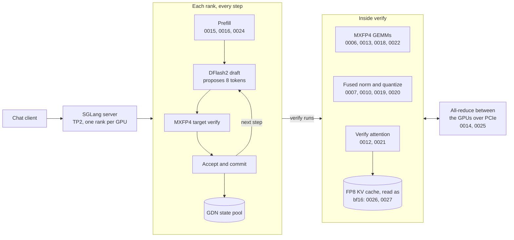
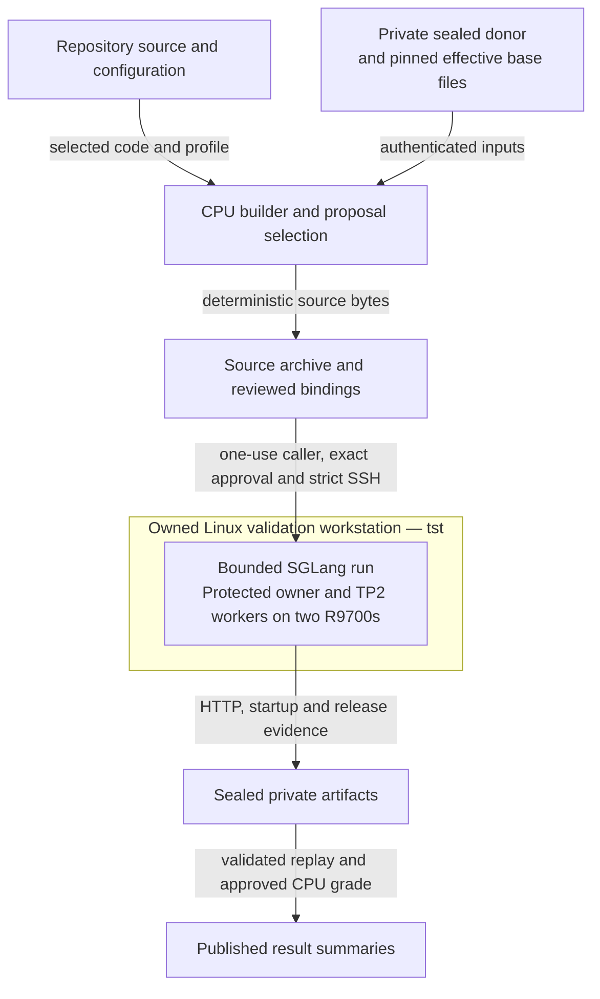
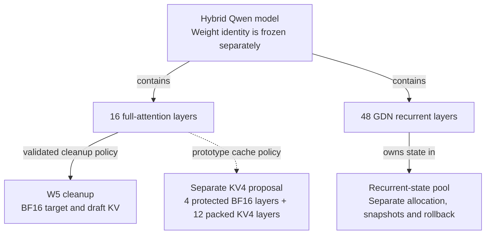

# Architecture

This page explains how the live server handles a request on two R9700 GPUs, and
which patches act at each step. The second half keeps the older architecture
of the SGLang 0.5.21 cleanup and the KV4 prototype, which are historical.

Terms are defined in the [glossary](README.md#glossary).

## How a request is served today

The model is split across both GPUs (TP2). Each step of generation runs the
same pipeline on both cards. The cards exchange partial results over PCIe after
each layer.

1. **Prefill.** The prompt is processed in chunks of 2,048 tokens. Its keys and
   values go into the KV cache.
2. **Draft.** The small DFlash2 draft model proposes 8 tokens.
3. **Verify.** The MXFP4 target model checks all 8 in one pass. This pass is
   where most of the gfx1201 patches act.
4. **Accept and commit.** The server keeps the accepted tokens, rolls back the
   rest and updates the GDN recurrent state.

The [patch series](../serving/patches/sglang-main/README.md) describes every
patch and shows which ones the live arms switch on.

## Weights, cache and recurrent state

These three are chosen separately. A weight format does not choose a cache
format.

| Part | Live choice | Notes |
| --- | --- | --- |
| Target weights | MXFP4 (Quark), 4-bit with a scale per 32 values | Patch 0004 serves them without AITER, which has no gfx1201 build |
| Draft model | DFlash2, BF16, 5 sliding-window layers | Proposes 8 tokens per step |
| Attention KV cache | FP8 e4m3 in arms UQS and UQL; BF16 in arm Y | FP8 halves the bytes per token. 0026 and 0027 convert it back to bf16 before the attention maths |
| Recurrent state | GDN state in its own pool | Separate allocation, snapshots and rollback |

The model has 64 layers: 16 full-attention layers and 48 GDN recurrent layers.
Only the attention layers use the KV cache.

## Historical: the SGLang 0.5.21 cleanup and KV4 prototype

Everything below describes the repository on 2026-11-02, before the November
reinstall wiped the 0.5.21 runtime. It is kept for readers of the older records.
The diagrams are functional views, not an installed deployment.

### From source to retained evidence

The cleaned serving path assembles an exact source selection before native
work. A separate reviewed caller owns the bounded workstation operation.
Model weights and the complete runtime stay outside this checkout.

The final readout combines local CPU replay with an isolated Linux CPU grade
when the approval permits it. The [caller sequence](../serving/launcher/README.md)
shows that ordering and the failure path. CPU checks alone do not establish
native ownership or GPU release.

| Source | Responsibility |
| --- | --- |
| [Serving source](../serving/README.md) | Configuration, assembly, runtime hooks, receipt validation and final-answer grading |
| [Patch series](../serving/patches/README.md) | The current [`sglang-main` series](../serving/patches/sglang-main/README.md) and the historical 0.5.21 overlays |
| [KV4 prototype](../prototype/) | Separate codec, attention kernels and selected SGLang source overlay |
| [Provenance](../provenance/) | Recorded identities, selections and bounded result summaries |

The diagram is grounded in `serving/build.py`, `propose_packet.py`,
`prepare_gpu_run.py`, `launcher/execute_once.py` and `quality/retained_replay.py`.
The completed packet is recorded in the
[cleanup sign-off](../serving/measurements/native-qualification/CLEANUP-SIGNOFF.md).

### Weights, attention KV and recurrent state (0.5.21)

A weight format does not choose a cache format. The completed W5 cleanup uses
BF16 target and draft attention KV. The separate KV4 proposal uses official FP8
model weights with a mixed attention-cache policy. Its public admission remains
closed.

The documented hybrid Qwen model has 64 physical layers. This diagram shows
alternative cache policies; the two full-attention branches are not successive
steps or simultaneously selected modes.

The layer counts and prototype policy come from the
[model fixture](../prototype/tests/fixtures/qwen3.8-27b-fp8.config.json) and
[cache contract](../prototype/image-source/python/sglang/srt/layers/attention/ultraquant_contract.py).
The W5 policy is explicit in its
[run configuration](../serving/config/runs/w5-v2/run.json).

### KV4 geometry and arithmetic

| Property | Recorded prototype contract |
| --- | --- |
| Full-attention physical IDs | `3,7,11,15,19,23,27,31,35,39,43,47,51,55,59,63` |
| Protected BF16 IDs | `3,7,59,63`; both K and V remain unrotated BF16 |
| Compact layers | The other twelve full-attention layers use local G32 E2M1/UE8M0 storage, with interleaved 17-byte groups |
| Per-rank TP2 geometry | 12 query heads, two KV heads, head dimension 256 and GQA ratio six |
| Transform | Compressed Q/K use FP32 Walsh-Hadamard transform after native MRoPE; V stays unrotated |
| Native arithmetic | BF16 input/output bits, local unpacking and FP32 accumulation |

This is a hybrid protection proposal, not a paper-qualified layer mapping.
The native ABI does not reinterpret BF16 as FP16 or claim native FP4 arithmetic.
Local packed bytes are not interchangeable with another engine's cache format.

The adapter joins the existing hybrid pool and backend through the parent's
physical-to-compact layer mapping. Cache identity binds rank, process, model,
source/build and policy. The owner protects cached prefixes and validates slot
generations before reads and writes. Failed preparation invalidates stale
metadata; packed bytes cannot be read through the ordinary BF16 path. The
historical Llama/TP1/FP16 guards remain separate.

### KV4 memory accounting

The mixed KV payload is 14,720 bytes per physical token per rank. A 4,096-slot
plan therefore has 60,293,120 payload bytes, plus 14,720 bytes for reserved slot
zero and a four-byte native status element. Metadata, allocator costs and GDN
reservation are additional. The 2 GiB workspace reserve is policy, not measured
use. The bounded Q/K/V contiguous-normalization temporary is at most 32 MiB.

For measured cleanup memory, use the
[operation-207 report](../serving/measurements/native-qualification/CLEANUP-SIGNOFF.md).
Its sampled driver values and startup byte witnesses have different scopes
from the prototype payload calculation above.
