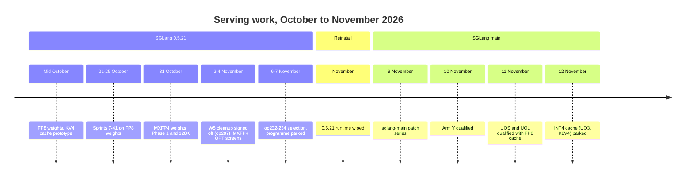

# History index

This page lists every older record in the repository and says what replaced it.
The records themselves are never edited. When a record is superseded, the note
goes here.

For what runs today, read the [README](../README.md). Terms such as "op234",
"W5" and "cap16" are defined in the [glossary](README.md#glossary).

## Timeline

## Eras

| Era | Dates | Runtime | Status |
| --- | --- | --- | --- |
| FP8 weights and KV4 prototype | Mid October to 26 October | SGLang 0.5.21, Torch 2.13/2.14 | Historical; runtime wiped |
| MXFP4 weights on 0.5.21 | 28 October to 7 November | SGLang 0.5.21, Torch 2.14, ROCm SDK 10.2 | Historical; runtime wiped |
| W5 serving cleanup | 31 October to 2 November | SGLang 0.5.21 | Historical; runtime wiped |
| SGLang `main` | 9 November onwards | SGLang `main` `fcb32746` with the `sglang-main` series | **Current** |

## Current records (SGLang main era)

These dated records describe the live stack. They are current as of their date.

| Record | What it says | Later note |
| --- | --- | --- |
| [UQ3-PHASE0A-PROXY-20261111.md](UQ3-PHASE0A-PROXY-20261111.md) | First offline ranking of 4-bit KV formats | Superseded by the real-data screen |
| [UQ3-PHASE0A-REAL-20261111.md](UQ3-PHASE0A-REAL-20261111.md) | Real Q/K/V screen; K8V4 looked best | INT4 kernel cost parked it on 12 November |
| [UQ3-INT4-VERIFY-KERNEL-20261112.md](UQ3-INT4-VERIFY-KERNEL-20261112.md) | INT4 verify attention is 1.6–2.3x FP8 time; UQ3 and K8V4 parked | Current |
| [DFLASH-BOUNDED-DRAFT-POOL-PLAN-20261111.md](DFLASH-BOUNDED-DRAFT-POOL-PLAN-20261111.md) | Plan to bound the DFlash draft KV pool for about 1.3x more target cache | The owner chose upstream SGLang [#47058](https://github.com/sgl-project/sglang/issues/47058) as the route on 12 November. The plan's statements that it "compounds with UQ3" and its 2.4x figure no longer apply, because UQ3 is parked |
| [AGENTS-LOG-20261112.md](../AGENTS-LOG-20261112.md) | The previous AGENTS.md: a running log of the op207–op234 work, copied unchanged to the repository root so its links still resolve | Replaced by the short [AGENTS.md](../AGENTS.md) |

## Records with misleading titles or claims

These records are accurate for their own time. Their titles or conclusions can
mislead a reader today.

| Record | Problem | Read instead |
| --- | --- | --- |
| [CURRENT-SERVING-RESULTS.md](CURRENT-SERVING-RESULTS.md) | Titled "current"; newest entry is op234 on 7 November (about 104 tok/s at one request) | The workstation [serving profile](https://github.com/Drgr33nSenior/ArchLinuxThreadripper/blob/main/infrastructure/ai-stack/serving/qwen3.8-27b-mxfp4-tp2.json) `qualification` list |
| [CURRENT-COST-ANALYSIS.md](CURRENT-COST-ANALYSIS.md) | Titled "current"; it predates Sprint 8 | [SPRINT8-COST-ATTRIBUTION.md](SPRINT8-COST-ATTRIBUTION.md) for its era |
| [FP8-TARGET-KV-DIAGNOSTIC-20261026.md](FP8-TARGET-KV-DIAGNOSTIC-20261026.md) | Says FP8 target KV "remains unselected and is not deployed" | FP8 KV is live in arms UQS and UQL through patches [0026 and 0027](../serving/patches/sglang-main/README.md) |
| [SPRINT37-FP8-KV-FEASIBILITY.md](SPRINT37-FP8-KV-FEASIBILITY.md) | Says to retain BF16 target and draft KV | As above |
| [SPRINT40-KV-CAPACITY.md](SPRINT40-KV-CAPACITY.md) | Keeps BF16 KV and defers 4-bit (UltraQuant) KV | FP8 KV is live; 4-bit KV was later screened and [parked](UQ3-INT4-VERIFY-KERNEL-20261112.md) |
| [QWEN4-SERVING-HANDOFF.md](QWEN4-SERVING-HANDOFF.md), [MXFP4-REMAINING-GATES.md](MXFP4-REMAINING-GATES.md) | Park the programme "for Qwen4" and call the profile unqualified | Work resumed on Qwen3.8 with the `sglang-main` series; arms Y, UQS and UQL are qualified |
| [NEXT-OPTIMIZATION-PLAN.md](NEXT-OPTIMIZATION-PLAN.md) | Superseded on 9 November | The [README](../README.md) research table |
| [PERFORMANCE-PLAN.md](PERFORMANCE-PLAN.md) | 15 October FP8 work order; says "current" throughout | Historical only |
| [HRX-UPSTREAM-REASSESSMENT-20261105.md](HRX-UPSTREAM-REASSESSMENT-20261105.md) | HIP pins belong to the wiped 0.5.21 runtime | Workstation [`stack.lock`](https://github.com/Drgr33nSenior/ArchLinuxThreadripper/blob/main/infrastructure/ai-stack/stack.lock) |

Several records carry an added "Status, 9 November 2026" note that calls the
`sglang-main` profile unqualified. That was true on 9 November. Arm Y was
qualified on 10 November and arms UQS and UQL on 11 November.

## Guides for the wiped runtime

These are procedures, not results. They describe how to run work on the SGLang
0.5.21 runtime. That runtime no longer exists, so none of them can be followed
today. Live validation uses the workstation's K3s bench and check Jobs.

| Guide | Covered |
| --- | --- |
| [HOST-OWNER.md](HOST-OWNER.md) | Host-process ownership for benchmark runs |
| [OWNER-COLLECTION.md](OWNER-COLLECTION.md) | Owner-run platform metadata collection |
| [KV4-OPERATIONS.md](KV4-OPERATIONS.md) | KV4 benchmark operator guide |
| [STATUS.md](STATUS.md) | KV4 prototype status |
| [BENCHMARKING.md](BENCHMARKING.md) | FP8/BF16-KV versus KV4 timing contract |
| [CACHE-GPU-TEST.md](CACHE-GPU-TEST.md), [CACHE-PATH.md](CACHE-PATH.md), [CACHE-PHASE-PROFILE.md](CACHE-PHASE-PROFILE.md), [METADATA-REUSE.md](METADATA-REUSE.md) | KV4 cache path, tests and profiling |
| [../serving/README.md](../serving/README.md) and everything under `serving/` except `patches/sglang-main/` | W5 cleanup source, caller workflow and grader |
| [../serving/launcher/README.md](../serving/launcher/README.md), [../serving/launcher/PROJECTION.md](../serving/launcher/PROJECTION.md) | One-use caller workflow |
| [../serving/quality/README.md](../serving/quality/README.md) | Op207 final-answer grader |
| [../serving/patches/README.md](../serving/patches/README.md) | The 0.5.21 overlay series |
| [../benchmarks/betterbench/README.md](../benchmarks/betterbench/README.md), [README.bundled.md](../benchmarks/betterbench/native-v2/README.bundled.md) | BetterBench preparation bytes, before the final client |
| [../.agents/skills/aithreadripper-serving-validation/references/evidence-workflow.md](../.agents/skills/aithreadripper-serving-validation/references/evidence-workflow.md) | Private evidence workflow for sealed roots |

## Records by era

Each group below is a set of dated records. All are historical. Matching
machine-readable summaries are in [`provenance/`](../provenance/), named the
same way with a date suffix.

### FP8 weights and the KV4 prototype (October 2026)

| Records | Topic |
| --- | --- |
| [FP8.md](FP8.md), [PROFILING.md](PROFILING.md) | Native FP8 baseline and its cache attribution |
| [SERVING-SPRINTS.md](SERVING-SPRINTS.md) | Index of sprints 7 to 41 |
| [SPRINT7-QUALIFICATION.md](SPRINT7-QUALIFICATION.md) to [SPRINT41-BF16-WEIGHT-FEASIBILITY.md](SPRINT41-BF16-WEIGHT-FEASIBILITY.md) (34 files) | One record per sprint, 21–25 October |
| [OPTIMIZATION-CANDIDATES.md](OPTIMIZATION-CANDIDATES.md), [REMAINING-FP8-OPTIMIZATIONS.md](REMAINING-FP8-OPTIMIZATIONS.md) | FP8 screening and the remaining programme |
| `FP8-*-COMPONENT.md`, [FP8-LAYOUT-COMPILE-GATE.md](FP8-LAYOUT-COMPILE-GATE.md), [FP8-C2-SINGLETON-METADATA.md](FP8-C2-SINGLETON-METADATA.md) (8 files) | Component screens, 23–24 October |
| [FP8-TARGET-KV-DIAGNOSTIC-20261026.md](FP8-TARGET-KV-DIAGNOSTIC-20261026.md) | FP8 KV diagnostic (see the table above) |
| [M8-3072-EXPERIMENTAL.md](M8-3072-EXPERIMENTAL.md), [LOSSY-PREFILL-COMPONENT.md](LOSSY-PREFILL-COMPONENT.md), [LOSSY-PREFILL-ROUTE.md](LOSSY-PREFILL-ROUTE.md), [EAGLE4-AND-LOSSY-COMMUNICATION.md](EAGLE4-AND-LOSSY-COMMUNICATION.md), [HOST-PATH-CLEANUP.md](HOST-PATH-CLEANUP.md) | Communication and host-path experiments, 22–25 October |
| [QWEN38-FROZEN-BASELINE.md](QWEN38-FROZEN-BASELINE.md), [QWEN38-REOPENED-TUNING.md](QWEN38-REOPENED-TUNING.md), [QWEN-NEXT-FEASIBILITY.md](QWEN-NEXT-FEASIBILITY.md), [QWEN-NEXT-WEIGHT-CANDIDATES.md](QWEN-NEXT-WEIGHT-CANDIDATES.md), [BF16-FP8-WEIGHT-COMPARISON.md](BF16-FP8-WEIGHT-COMPARISON.md) | Model and weight-format choices |
| [../benchmarks/results/20261025-final-baseline/README.md](../benchmarks/results/20261025-final-baseline/README.md), [../benchmarks/results/20261025-host-path/README.md](../benchmarks/results/20261025-host-path/README.md), [../benchmarks/host-path/README.md](../benchmarks/host-path/README.md) | BetterBench checkpoints, 25 October |

### MXFP4 weights on 0.5.21 (28 October to 7 November)

| Records | Topic |
| --- | --- |
| [MXFP4-CANDIDATE-PHASE1.md](MXFP4-CANDIDATE-PHASE1.md), [MXFP4-CANDIDATE-128K.md](MXFP4-CANDIDATE-128K.md) | First MXFP4 benchmark and 128K profile |
| [MXFP4-P3-FUSED-NORM-CANDIDATE.md](MXFP4-P3-FUSED-NORM-CANDIDATE.md), [MXFP4-TILE-GEOMETRY-CANDIDATE.md](MXFP4-TILE-GEOMETRY-CANDIDATE.md) | Early kernel candidates, 28 October |
| [MXFP4-OPTIMIZATION-SPRINT-PLAN.md](MXFP4-OPTIMIZATION-SPRINT-PLAN.md), [MXFP4-FOLLOWUP-SPRINTS.md](MXFP4-FOLLOWUP-SPRINTS.md) | Plans for the MXFP4 programme |
| `MXFP4-OPT00-…` to `MXFP4-OPT07-…` (15 files) | OPT screens, 3–4 November |
| [MXFP4-EFFECTIVE-BANDWIDTH-LEADS.md](MXFP4-EFFECTIVE-BANDWIDTH-LEADS.md), [MXFP4-JOINT-CENSUS-AND-PRIORITIES.md](MXFP4-JOINT-CENSUS-AND-PRIORITIES.md), [MXFP4-BW04-ALLOCATION-ROUTE.md](MXFP4-BW04-ALLOCATION-ROUTE.md), [MXFP4-REMAINING-LEAD-CONTINUATION.md](MXFP4-REMAINING-LEAD-CONTINUATION.md), [MXFP4-CERTIFIED-HEAD-CPU-SCREEN.md](MXFP4-CERTIFIED-HEAD-CPU-SCREEN.md), [MXFP4-REDUCED-DIAGNOSTIC-PREPARATION.md](MXFP4-REDUCED-DIAGNOSTIC-PREPARATION.md) | Bandwidth and output-head leads |
| [MXFP4-GEMM-WAVE-HINT-SCREEN.md](MXFP4-GEMM-WAVE-HINT-SCREEN.md), [MXFP4-GEMM-WAVE-HINT-CPU-RESULTS.md](MXFP4-GEMM-WAVE-HINT-CPU-RESULTS.md) | Gate/up wave-hint screen |
| [MXFP4-FOUR-MEMBER-SERVING-VALIDATION.md](MXFP4-FOUR-MEMBER-SERVING-VALIDATION.md), [MXFP4-THREE-MEMBER-SERVING-VALIDATION.md](MXFP4-THREE-MEMBER-SERVING-VALIDATION.md), [MXFP4-REJECTED-TRIAL-REASSESSMENT-20261106.md](MXFP4-REJECTED-TRIAL-REASSESSMENT-20261106.md) | Bundle validation, 4–6 November |
| [MXFP4-SELECTED-CAP16-BETTERBENCH.md](MXFP4-SELECTED-CAP16-BETTERBENCH.md) | Op233 BetterBench repeat, 7 November |
| [MXFP4-REMAINING-GATES.md](MXFP4-REMAINING-GATES.md), [QWEN4-SERVING-HANDOFF.md](QWEN4-SERVING-HANDOFF.md) | Op234 selection and parking (see the table above) |
| [../benchmarks/betterbench/native-v2/README.md](../benchmarks/betterbench/native-v2/README.md) | The BetterBench client's history. The client itself is still used by the live bench Job |

### W5 serving cleanup (31 October to 2 November)

| Records | Topic |
| --- | --- |
| [../serving/HISTORY.md](../serving/HISTORY.md) | Implementation log of the cleanup |
| [../serving/proposals/README.md](../serving/proposals/README.md), [PROTECTED-CONFIG-MIGRATION.md](../serving/proposals/PROTECTED-CONFIG-MIGRATION.md) and the 43 `serving/proposals/*/README.md` files | One record per source increment |
| [../serving/measurements/native-qualification/CLEANUP-SIGNOFF.md](../serving/measurements/native-qualification/CLEANUP-SIGNOFF.md) | Op207 sign-off: 352 of 352 responses matched and passed grading |
| [native-qualification/README.md](../serving/measurements/native-qualification/README.md), [TESTING.md](../serving/measurements/native-qualification/TESTING.md), [gpu-run](../serving/measurements/gpu-run/README.md), [production-cleanup](../serving/measurements/production-cleanup/README.md), [reference-replay](../serving/measurements/reference-replay/README.md), [final-campaign](../serving/measurements/final-campaign/README.md) | Measurements leading to the sign-off |

### Earlier versions of the living docs

The living docs were rewritten on 12 November 2026. Their earlier text is in Git
history, for example `git show cfed072:README.md`.
