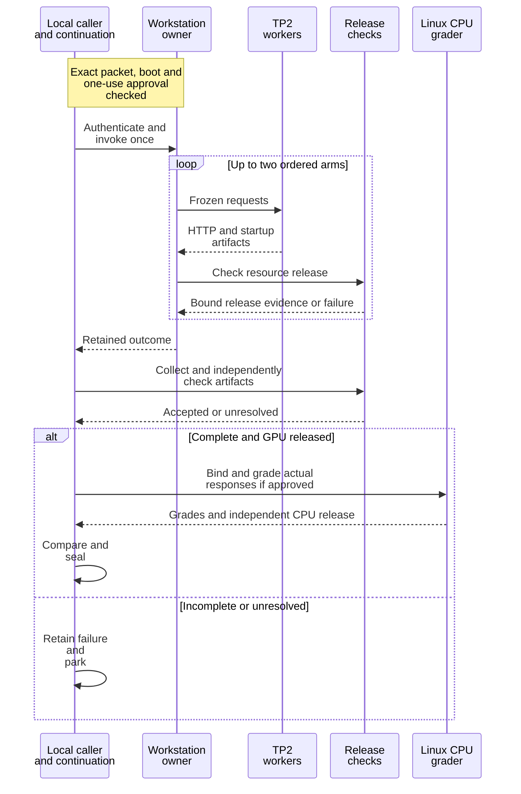

# One-use caller workflow

These sources support a reviewed, bounded serving campaign. They connect an
exact source author, configured host, observed boot and owner approval to one
invocation. This directory is canonical source; a runnable private packet also
needs authenticated inputs and registration.

For preparation, read [caller projection](PROJECTION.md). For checks before a
new run, read the [test procedure](../measurements/native-qualification/TESTING.md).
For the completed cleanup, read the
[sign-off](../measurements/native-qualification/CLEANUP-SIGNOFF.md).

## Responsibilities

| Component | Responsibility |
| --- | --- |
| `run_native.py` | Authenticate the grant, source inventory and exact upload/launch inputs |
| `execute_once.py` | Enforce one invocation, run finite steps, collect failures and retain the caller result |
| `power_observe.py` | Validate the pinned host configuration and observe the approved power caps |
| Generated caller dependencies | Supply the pinned SSH connection, finite command runner, collectors and release observers |
| Protected workstation owner | Admit and supervise the workload, retain resource records and verify release |
| Approved grading continuation | Bind actual completed responses and run the eligible isolated CPU grade |

## One campaign, including the failure path

This sequence is a functional view of the reviewed W5 workflow as of
2026-11-02. It starts with an approved packet; source preparation occurs before
it. The caller and the separately approved continuation are shown as one role.
The second arm starts only after the first arm's acceptance and release gates
pass.



`execute_once.py` ends after the native campaign, collection and postchecks.
It does not automatically authorize or dispatch the later grade. The actual
input binder and approved continuation enforce that separate condition.
Failures keep their original status; a later local reader correction cannot
turn an incomplete native operation into a completed one.

## Power and identity checks

`power_observe.py` reads `host_config` and `host_sha256` from the generated caller
binding. It requires canonical, bounded, singly linked JSON below `config/host/`.
Unknown fields, wrong pins, duplicate render nodes, type aliases and caps above
the fixed 235 W ceiling fail before remote work. Configured watts are converted
to integer microwatts.

The remote observer retains the boot, owner-journal, fresh-root, render/sysfs
and descriptor-close checks. It observes caps and rejects a mismatch; it does
not change power settings. Device wake and privileged observation belong to
the exact reviewed caller and its approved operation.

Each GPU invocation needs the handoff's fresh, exact, one-use owner approval.
A reboot needs a fresh boot approval. No automatic retry is included, and no
competing workload is stopped to obtain ownership. The
[host-owner guide](../../docs/HOST-OWNER.md) describes the underlying boundary
and its historical KV4 integration records.

## Local verification

From the repository root:

```sh
python3.14 -I -B -S serving/tests/test_caller_power.py -v
python3.14 -I -B -S serving/tests/test_one_use_caller.py -v
```

The public tests substitute SSH and remote effects. The power tests cover
235 W and 230 W configurations, invalid inputs, observed mismatches and failure
retention. These checks do not contact the workstation, wake a device or start
a GPU workload. Use the exact-packet gates before requesting native work.
