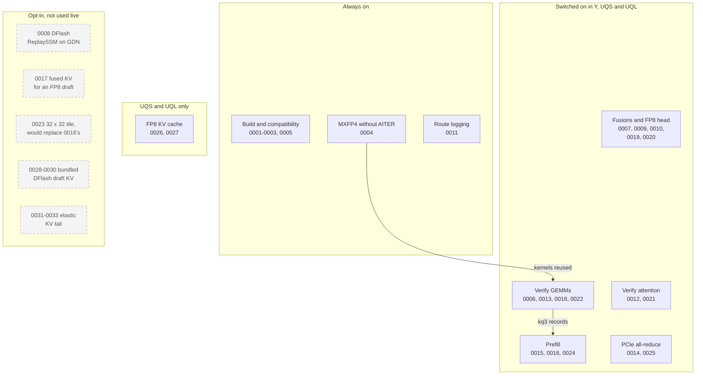

# SGLang main patch series

These 33 patches make SGLang `main` serve Qwen3.8-27B MXFP4 well on gfx1201
(the R9700). The workstation's AI-stack pipeline applies them before it builds
the serving image.

## How the series is used

- The build applies every `*.patch` here in name order with `git apply`, with no
  fuzz. It stops if any patch fails.
- The workstation's
  [`stack.lock`](https://github.com/Drgr33nSenior/ArchLinuxThreadripper/blob/main/infrastructure/ai-stack/stack.lock)
  pins the SGLang commit and a content hash of this series,
  `SGLANG_PATCHSET_SHA256`. It does not pin a commit of this repository.
- Today it pins SGLang `fcb3274646e43c16d70fd83806ebb3a5134d5e81` and patchset
  `142d0ae78fa1a4a48b7aa1e1a78baa28b2df10533b9304b178d89803279db10f`, which is
  patches `0001` to `0027`. The live UQS image was built from exactly that pair
  on 2026-11-11.
- Patches `0028` to `0030` (13 November) are not in any image yet. With them
  the series hash is
  `40067ef9288c4cc26d98f1d006c1323806ffb7d0635fa078c27ff37a5868bf74`, and all
  30 patches apply in order to `fcb32746`. `stack.lock` must move to that hash
  before the next build, or `sync.sh` and the build stop.
- Patches `0031` to `0033` (14 November) add the elastic KV tail. They are
  CPU-tested only and in no image. With them the series hash is
  `d9af3651b8857720c996ec27c4341437c1ef80a78cc49cf0eb14536a8565f9cd`, and all
  33 patches apply in order to `fcb32746`.
- Most patches add a kernel route behind an environment switch that is off by
  default. The workstation's
  [serving profile](https://github.com/Drgr33nSenior/ArchLinuxThreadripper/blob/main/infrastructure/ai-stack/serving/qwen3.8-27b-mxfp4-tp2.json)
  turns switches on per arm.

## Change a patch

1. Edit, add or remove the `*.patch` file. Keep the four-digit order.
2. Check that the series still applies to the pinned SGLang commit, as in
   [Verification](../../../docs/VERIFICATION.md#check-the-patch-series).
3. Recompute the hash with the workstation's
   [`patchset-hash.sh`](https://github.com/Drgr33nSenior/ArchLinuxThreadripper/blob/main/infrastructure/ai-stack/patchset-hash.sh)
   and update `SGLANG_PATCHSET_SHA256` in `stack.lock`. `refresh.sh` also
   recomputes it when it moves every pin. `sync.sh` and the build stop if the
   hash and the series differ.
4. Add a row to the table below and a section to the patch notes.
5. A new switch stays off until a profile arm enables it after a bench Job and
   the quality menu.

When upstream SGLang absorbs a patch, delete it here and name the upstream
commit in the commit message.

## Map of the series

Solid arrows show which patches build on others. Grey dashed boxes are opt-in
patches that no live arm switches on.

## Patches

"Live arms" are the profile arms that turn a patch on: Y (BF16 KV, qualified
2026-11-10) and UQS and UQL (FP8 KV, qualified 2026-11-11). "All" means the
patch has no switch. "Not built" means no image contains the patch yet. Each patch number links to its full notes.

| Patch | What it does | Switch | Used by live arms |
| --- | --- | --- | --- |
| [0001](#0001-gfx1201-aot-build) | Allow gfx1201 in the AOT kernel build, with wave32 | Always on | All |
| [0002](#0002-rocm-aot-cxx20) | Compile the ROCm AOT kernels as C++20, which Torch 2.14+ needs | Always on | All |
| [0003](#0003-outlines-python314) | Skip `outlines` on Python 3.14, which it does not support | Always on | All |
| [0004](#0004-gfx1201-mxfp4-without-aiter) | Serve MXFP4 weights on gfx1201 without AITER, using vendored AITER kernels | Always on | All |
| [0005](#0005-pillow13) | Require Pillow 13, which fixes five critical CVEs | Always on | All |
| [0006](#0006-gfx1201-mxfp4-verify-gemm) | Split-K MXFP4 GEMM for verify rows on the down and output projections (op234 S4) | `SGLANG_GFX1201_SPLITK_DOWNOUT` | Y, UQS, UQL |
| [0007](#0007-gfx1201-packed-gdn-in-proj) | One packed MXFP4 GEMM for the GDN input projections | `SGLANG_GFX1201_PACKED_GDN_IN_PROJ` | Y, UQS, UQL |
| [0008](#0008-dflash-gdn-replayssm-commit) | Let DFlash run with ReplaySSM speculation on GDN models | `--enable-linear-replayssm-spec` | None (experiment arms only) |
| [0009](#0009-gfx1201-fp8-lm-head) | FP8 copy of the LM head for verify and draft projections | `SGLANG_GFX1201_FP8_LM_HEAD` | Y, UQS, UQL |
| [0010](#0010-gfx1201-gdn-norm-quant) | Fuse the GDN output norm with MXFP4 quantization (op234 F1) | `SGLANG_GFX1201_GDN_NORM_QUANT` | Y, UQS, UQL |
| [0011](#0011-gfx1201-route-markers) | Log one line per shape when the 0006 or 0010 route runs | Always on (logging only) | All |
| [0012](#0012-gfx1201-verify-attention) | Verify attention through upstream's gfx1151 split-KV kernel, 32 splits | `SGLANG_GFX1201_VERIFY_ATTENTION` | Y, UQS, UQL |
| [0013](#0013-gfx1201-splitk-wide) | Extend 0006's split-K to the other under-filled verify GEMMs | `SGLANG_GFX1201_SPLITK_WIDE` | Y, UQS, UQL |
| [0014](#0014-gfx1201-pcie-custom-all-reduce) | SGLang's custom all-reduce over PCIe for two gfx1201 GPUs | `SGLANG_GFX1201_PCIE_CUSTOM_AR` | Y, UQS, UQL |
| [0015](#0015-gfx1201-p1-prefill) | P1 route: block-FP8 GEMMs for prefill chunks of 1,024-2,048 rows | `SGLANG_GFX1201_P1_PREFILL` | Y, UQS, UQL |
| [0016](#0016-gfx1201-extend-attention-warps8) | Prefill attention with 8 warps at head dim 256 (op234 C4) | `SGLANG_GFX1201_EXTEND_WARPS8` | Y, UQS, UQL |
| [0017](#0017-dflash-fused-kv-fp8-draft) | Keep DFlash's fused KV path when the draft is quantized to FP8 | `SGLANG_DFLASH_FUSED_KV_FP8` | None (experiment arms only) |
| [0018](#0018-gfx1201-splitk-fused-reduce) | Run the 0006/0013 split-K GEMMs and their reduction as one kernel | `SGLANG_GFX1201_SPLITK_FUSED_REDUCE` | Y, UQS, UQL |
| [0019](#0019-gfx1201-add-norm-mxfp4) | Fuse residual add, RMSNorm and MXFP4 quantization at layer boundaries | `SGLANG_GFX1201_ADD_NORM_MXFP4` | Y, UQS, UQL |
| [0020](#0020-gfx1201-silu-mul-mxfp4) | Fuse SiLU(gate) x up with the down projection's MXFP4 quantization | `SGLANG_GFX1201_SILU_MUL_MXFP4` | Y, UQS, UQL |
| [0021](#0021-gfx1201-verify-attention-b1-tile) | Wider verify-attention tile when only one request is in flight (needs 0012) | `SGLANG_GFX1201_VERIFY_ATTENTION_B1_TILE` | Y, UQS, UQL |
| [0022](#0022-gfx1201-mxfp4-kq3) | kq3: a Gluon MXFP4 GEMM on pre-packed weights for verify batches (needs 0018) | `SGLANG_GFX1201_MXFP4_KQ3` | Y, UQS, UQL |
| [0023](#0023-gfx1201-extend-attention-tile32) | 32 x 32 prefill-attention tile; faster but not bitwise | `SGLANG_GFX1201_EXTEND_TILE32` | None (experiment arms only) |
| [0024](#0024-gfx1201-p1-from-kq3) | P1 prefill builds its FP8 weight straight from kq3 records (needs 0015, 0022) | `SGLANG_GFX1201_P1_FROM_KQ3` | Y, UQS, UQL |
| [0025](#0025-gfx1201-prefill-custom-all-reduce) | Let prefill-chunk reductions use the PCIe custom all-reduce (needs 0014) | `SGLANG_GFX1201_PCIE_CUSTOM_AR_MAX_BYTES` above 16 MiB | Y, UQS, UQL |
| [0026](#0026-gfx1201-fp8-kv-dequant) | Keep the KV cache in FP8 and read it as bf16 in the attention kernels | `SGLANG_GFX1201_FP8_KV_DEQUANT` with an FP8 KV cache | UQS, UQL |
| [0027](#0027-gfx1201-fp8-kv-hw-decode) | Decode FP8 KV with gfx1201's hardware convert instruction (needs 0026) | Automatic with 0026 | UQS, UQL |
| [0028](#0028-upstream-47057-swa-checkpoint-windows) | Upstream PR #47057: keep sliding-window KV only for the window before each cached Mamba checkpoint | `CacheInitParams.swa_checkpoint_windows`, set by 0029's flag | None (not built) |
| [0029](#0029-upstream-47058-dflash-draft-kv-bundling) | Upstream PR #47058: size the DFlash draft KV pool by Mamba checkpoints instead of one slot per target token (needs 0028) | `--speculative-draft-kv-bundling` | None (not built) |
| [0030](#0030-gfx1201-draft-kv-bundling) | Guards and CPU tests for 0029 on this stack (needs 0029) | With 0029's flag | None (not built) |
| [0031](#0031-gfx1201-elastic-kv-tail-allocator) | Token allocator hands out slots above a base only while a tail is open, low slots first; lists the tail slots in use | `SGLANG_GFX1201_ELASTIC_KV_BASE_TOKENS` | None (not built) |
| [0032](#0032-gfx1201-elastic-kv-tail-buffers) | Target KV buffers over HIP virtual memory with one mappable tail extent each; the tail's shrink and grow logic (needs 0031, 0029) | `SGLANG_GFX1201_ELASTIC_KV_BASE_TOKENS` | None (not built) |
| [0033](#0033-gfx1201-elastic-kv-tail-control) | Scheduler control request and `/kv_tail` endpoint for the tail; CPU tests (needs 0032) | `SGLANG_GFX1201_ELASTIC_KV_BASE_TOKENS` | None (not built) |

The `sglang-0.5.21/` directory is the older overlay series for the wiped
SGLang 0.5.21 image. It is kept as history. Port a change from it only after
checking that upstream `main` still lacks it.

## What came over from the 0.5.21 runtime (op234)

Op234 was the final profile on the old SGLang 0.5.21 runtime. Its measured
speed and quality do not carry over; each ported idea was measured again on
SGLang `main`.

| Op234 component | In this series |
| --- | --- |
| gfx1201 AOT build and wave32 | `0001` |
| AITER-derived MXFP4 quantizer and FP4 GEMM | `0004`, byte-identical |
| S4 split-K for down and output, gate/up wave hint | `0006` |
| Packed GDN input projection (operation 164) | `0007` |
| D3b FP8 target and draft heads | `0009`, one shared FP8 copy |
| F1 gated-norm and MXFP4 quantize fusion | `0010` |
| P1 prefill route | `0015`, extended by `0024` |
| C4 prefill attention | `0016` |
| Ring-fold ReplaySSM spec path | `0008` uses upstream's GDN compact replay instead; not used live |
| Verify prefetch, split-KV adapter, cap16 | Not carried. `0012` and `0021` use upstream's gfx1151 verify kernel with 32 splits instead |
| P3 fused Gemma RMSNorm | Not needed: upstream's fused RMSNorm kernel already serves gfx1201 |
| Eleven 0.5.21 W5 overlays | Not carried |
| KV4 (UltraQuant) cache library | Not carried. `0026` keeps its idea of reading a compact cache as BF16, for an FP8 cache; `0027` decodes FP8 in hardware |

## Patch notes

These notes give each patch's design and measurements, as written when the
patch was added.

### 0001-gfx1201-aot-build

Allow gfx1201 in the AOT kernel build, require an explicit `AMDGPU_TARGET`, and build with wave32 (`SGLANG_WAVEFRONT_SIZE=32`). Ported unchanged from the 0.5.21 common-runtime overlay.

### 0002-rocm-aot-cxx20

Compile the ROCm AOT kernels as C++20. Torch 2.14+ headers stop with `#error` below C++20; upstream's CUDA build already uses C++20, but `setup_rocm.py` still passes `-std=c++17`.

### 0003-outlines-python314

Skip `outlines` on Python 3.14 in `runtime_common`. Its pinned `outlines_core==0.1.26` has no 3.14 wheel and current `outlines` requires Python below 3.14. SGLang imports it only for `--grammar-backend outlines`; xgrammar stays the default, as in the qualified 0.5.21 runtime, which shipped no outlines.

### 0004-gfx1201-mxfp4-without-aiter

Serve dense Quark MXFP4 on gfx1201, which has no AITER build. Adds `gfx1201_mxfp4_kernels.py`, the qualified op234 runtime's AITER-derived Triton quantizer and FP4 GEMM (MIT, from ROCm/aiter `32214c29`, byte-identical, sha256 `5571b106…`), and `gfx1201_mxfp4.py` with that runtime's launch geometry. When `aiter` is not installed and the GPU is gfx1201, `quark_w4a4_mxfp4.py` uses them; AITER-only routes raise `NotImplementedError`. The MXFP4 and INT4-FP8 MoE schemes import without AITER; `ON_GFX950` stays defined on every HIP host. Upstream otherwise imports AITER at module load on HIP, which stops the scheduler from importing.

### 0005-pillow13

Require Pillow 13 (`>=13.0.0,<14`) in `runtime_base`. Pillow 12.3.0 has five CRITICAL CVEs fixed in 13.0.0 (CVE-2026-112393, -112398, -112403, -112900, -96639), which blocked the image's scan policy. Upstream caps `<13` because its Rust image pipeline, used only by the inkling and deepseek_v41 processors, reproduces Pillow 12 bicubic. Qwen3.8's processor does not use it: `pixel_values` and decoded JPEG/PNG/WebP pixels were bit-identical under Pillow 12.3.0 and 13.0.0 (2026-11-09).

### 0006-gfx1201-mxfp4-verify-gemm

gfx1201 MXFP4 GEMM launches for DFLASH verify rows (M8/M16), each off unless its variable is `1`. `SGLANG_GFX1201_SPLITK_DOWNOUT`: op234's S4 split-K for down (5120x8704) and output (5120x3072) shards, four K partitions into a shared 1.25 MiB FP32 buffer and a fixed-order reducer; falls back to one partition if the buffer would be allocated inside graph capture. `SGLANG_GFX1201_GATE_UP_WAVE0`: `waves_per_eu=0` for gate/up (17408x5120). Measured on R9700 (2026-11-09): split-K down 88 to 67 us, output 34 to 30 us per call, outputs bitwise equal; wave0 2 us slower, so leave it off.

### 0007-gfx1201-packed-gdn-in-proj

`SGLANG_GFX1201_PACKED_GDN_IN_PROJ=1`: one MXFP4 quantize and GEMM for the 48 GDN QKVZ (8192 rows) and BA (48 rows) input projections on M8/M16 rows (op234 operation 164). The original parameters become views of the packed rows, so no weight is duplicated. Outputs are bitwise equal to the separate projections; measured 101 to 76 us (M8) and 92 to 76 us (M16). Also passes `prepare_before_cuda_graph_capture` through the dense `Qwen3_5ForConditionalGeneration` wrapper, which upstream omits, so pre-capture hooks reach the language model.

### 0008-dflash-gdn-replayssm-commit

Lets `--enable-linear-replayssm-spec` run DFLASH on GDN models. Upstream refuses it (`kv_cache_configurator.py:971`) because DFLASH commits through the backend's KDA-only ReplaySSM handler. This routes DFLASH's GDN commit through `commit_mamba_states_after_verify`, upstream's GDN compact-replay commit (cursor advance, checkpoint fold, conv rollback, track snapshots), and relaxes the guard for DFLASH with KDA or GDN. DSPARK stays KDA-only.

### 0009-gfx1201-fp8-lm-head

`SGLANG_GFX1201_FP8_LM_HEAD=1`: a block-128 FP8 copy of the dense BF16 LM head (op234 D3b), built before graph capture and used for target verify rows (8, 16; FP32 output) and the draft's candidate projection (7, 14; BF16 output). One copy serves both because the draft borrows the target head. Uses upstream's per-token-group quantizer and block FP8 matmul with op234's small-row tile. Measured 2.04 ms to 1.12 ms per call (124160x5120 shard). Lossy: on random data max logit error about 2% of the logit range and top-1 agreement 93 to 100%, so qualify with the bench quality phase.

### 0010-gfx1201-gdn-norm-quant

`SGLANG_GFX1201_GDN_NORM_QUANT=1`: fused GDN output gated RMSNorm and MXFP4 quantization (op234 F1) on 8- and 16-token rows. The kernel is op234's copy of the FLA gated-norm forward with its store replaced by the vendored AITER MXFP4 quantizer. It rounds to BF16 before quantizing, so `out_proj` receives the same packed values and scales the unfused path would produce. It is the MXFP4 counterpart of upstream's FP8 tuple path in the same function. Measured on R9700 (24 heads x 128): 54.5 to 21.1 us per layer at 8 tokens, bitwise equal.

### 0011-gfx1201-route-markers

Logging only: one INFO line per shape when the split-K verify GEMM (0006) or the fused GDN norm-quant (0010) route runs, and, when 0010 is enabled but skipped for a decode- or verify-sized input, one line per shape giving the shapes, dtypes, strides and `out_proj` scheme it saw. Neither route logged before, so a bench could not show whether it engaged. No behaviour change.

### 0012-gfx1201-verify-attention

`SGLANG_GFX1201_VERIFY_ATTENTION=1`: run DFLASH/EAGLE target verify through upstream's gfx1151 split-KV verify kernel (`verify_attention_gfx1151`, written for Qwen3.8 shapes) on gfx1201, with 32 splits instead of gfx1151's 20, and log its route. Upstream gates the kernel to gfx115x, so verify on gfx1201 ran `extend_attention_fwd`, which walks the whole prefix serially. On the R9700 with TP2 Qwen3.8 shapes (12 q heads, 2 kv heads, head dim 256, 8 draft tokens) it takes 0.029 / 0.047 / 0.100 / 0.249 / 0.449 ms per layer at 1k / 8k / 23.5k / 47k / 88k prefixes against 0.255 / 1.64 / 4.38 / 8.98 / 16.7 ms, max abs difference 1e-3 (BF16 rounding; not bitwise). Also drops the triton backend's now-unused `use_gfx115_kernels` import.

### 0013-gfx1201-splitk-wide

`SGLANG_GFX1201_SPLITK_WIDE=1`: 0006's split-K for the remaining under-filled verify shards (M8/M16): 4 K partitions for the packed GDN input projection (8240x5120) and attention QKV (7168x5120), 2 for gate/up (17408x5120). Generalises the partial buffer (sized from the shape table, 2.1 MiB) and the fixed-order reduce to any partition count; 0006's down/out routes are unchanged and still bitwise equal. Measured inside a captured, DRAM-fed graph on the R9700: 77.9 to 67.5, 66.7 to 58.3 and 137.5 to 127.9 us per call at M8 (about -1.25 ms per verify step), outputs bitwise equal to one partition on random data. The 2026-11-09 sweep found 1/2/4/8 partitions and BLOCK_N 32 (2-3x slower) for every shape; split-K closes only part of the gap to the bandwidth floor (gate/up 128 us against 75 us).

### 0014-gfx1201-pcie-custom-all-reduce

`SGLANG_GFX1201_PCIE_CUSTOM_AR=1`: SGLang's HIP custom all-reduce (1-stage) for two gfx1201 GPUs over PCIe, for reductions up to `SGLANG_GFX1201_PCIE_CUSTOM_AR_MAX_BYTES` (512 KiB: verify/decode; prefill chunks stay on RCCL). SGLang only admits it over XGMI, and the stock kernel is wrong here: its relaxed start flag reaches the peer before the input leaves L2, and on two R9700s 2,000 reductions gave 2.5 M wrong elements with the two ranks disagreeing, even with a full sync and barrier before each call. For gfx12 device code the start flag becomes a system-scope release and its wait a system-scope acquire (XGMI builds unchanged). With the fix: 0 wrong elements in 100,000 eager and 192,000 graph-captured reductions at 8 and 16 rows, 11.2 / 13.9 us per call in a graph (RCCL 19-37 us). The IPC buffers keep their stock size because a smaller torch allocation is not a hipMalloc base and cannot be exported.

### 0015-gfx1201-p1-prefill

`SGLANG_GFX1201_P1_PREFILL=1`: the P1 prefill route (P1-NUMERICAL-CONTRACT-v1, setting `fp8-g128-b101-m1024-v1`, operation 93) for dense MXFP4 linears on gfx1201. Prefill calls of 1024-2048 rows on the five TP2 shapes (17408x5120, 8192x5120, 7168x5120, 5120x3072, 5120x8704) expand the MXFP4 weight losslessly to block FP8 into one per-card scratch (108 MB), quantize activations to FP8 per 128-column group and run the block-FP8 GEMM; decode/verify rows, graph capture and every other shape stay on MXFP4. The kernels (`gfx1201_p1_fp8_kernels.py`) are the accepted `p1_fp8_kernels.py` byte for byte (sha256 `0d291927`); the route is the serving repository's `p1_prefill.py` with its import path, logger markers and a re-validation for 0007's packed GDN input projection. Every admitted shard is expanded at load and must have zero guard flags; both M variants compile before traffic. Measured on the R9700 against the MXFP4 route: 2.8-3.3x per GEMM, 960 to 321 ms of GEMM time per card for a 2048-row chunk, expansion bitwise equal to the dequantized MXFP4 weight, relative error against an FP32 reference 2.6% against 11.2% (FP8 instead of FP4 activations). Not bitwise equal to the MXFP4 route, so it must pass the bench quality phase.

### 0016-gfx1201-extend-attention-warps8

`SGLANG_GFX1201_EXTEND_WARPS8=1`: C4 (operations 173/174) on SGLang main. `extend_attention_fwd` (prefill attention) uses 8 warps instead of 4 for the gfx1201 head-dim-256 shape only (Lq = Lv = 256, BLOCK 64x64, 4 warps, 1 stage, input on a gfx1201 device). On 0.5.21 it cut cold 64K-118K prefill by 23% with all final answers matched. Re-measured on main's kernel (compact tile grid) on the R9700 with TP2 shapes (12 q / 2 kv heads), one 2048-token chunk: 7.3 to 6.4, 27.8 to 23.5, 55.6 to 46.8 and 102.6 to 85.2 ms at 8K / 32K / 64K / 118K prefixes (-13 to -17%; 70 / 142 / 278 ms per chunk over 16 attention layers), +0.06 ms with no prefix; max abs difference 2.4e-4 (not bitwise).

### 0017-dflash-fused-kv-fp8-draft

`SGLANG_DFLASH_FUSED_KV_FP8=1`: keep DFLASH's fused KV materialization when the draft is quantized to FP8 (`--speculative-draft-model-quantization fp8`). The fused path stacks every draft layer's K/V projection rows into one BF16 weight for a single context-KV GEMM per round, but refused any quantized `qkv_proj`; with an FP8 draft, context KV then went through the sequential path (the full QKV projection per layer, Q discarded), which offset most of the FP8 saving (2026-11-09 arm L: 34.52 against 34.61 ms per verify step). With the switch, a non-block FP8 `qkv_proj` (Fp8LinearMethod, weight stored (K, N), per-tensor or per-channel scale) is admitted and only its K/V rows are dequantized into the stacked weight at load. Checked on the R9700 through `Fp8LinearMethod` with a non-square layer: the dequantized rows are 2.6% from the BF16 weight (FP8 rounding), closer than the FP8 layer's own output (3.8%, which also rounds activations); BF16 drafts are sliced exactly as before. Changes only draft proposals, so acceptance, not output quality.

### 0018-gfx1201-splitk-fused-reduce

`SGLANG_GFX1201_SPLITK_FUSED_REDUCE=1`: run the split-K verify GEMMs of 0006/0013 as one kernel. The last partition of each output tile (counted by an agent-scope acq_rel atomic) re-reads the FP32 partials with device-scope loads and sums them in the reduce kernel's fixed order, so the output is bitwise equal to GEMM + `_splitk_reduce_kernel`, and 256 kernel launches per verify round disappear (~2.2 us each inside a graph on gfx1201). New module `gfx1201_mxfp4_splitk.py`, generated from the vendored AITER kernel (main loop textually identical; `gfx1201_mxfp4_kernels.py` stays byte-identical). The ordering relies on `s_wait_storecnt 0x0` in every wave before the workgroup barrier, which Triton 3.9 emits on gfx1201; `fused_splitk_asm_ok` checks that, the device-scope atomic and the device-scope reloads in each compiled variant once, and a variant that fails uses the two-kernel path (doctored code is refused). Checked on the R9700: 0 mismatches in 340,000 calls per shape and row count (eager and graph, partials NaN-poisoned before every call) while a first-arrival negative control fails on every shape; counters return to zero; 0.63 / 0.65 ms less per round at M8 / M16 through `gemm_afp4wfp4`. An independent review flagged that without the per-wave store drain the scheme would be unsound; write-through stores and bypass reloads were slower (0.45 ms worse at M16).

### 0019-gfx1201-add-norm-mxfp4

`SGLANG_GFX1201_ADD_NORM_MXFP4=1`: on target-verify batches of 8 or 16 rows, the layer boundary's norm read (residual add + Gemma RMSNorm) also quantizes to MXFP4 in the same kernel (`gfx1201_add_norm_mxfp4.py`) and hands the (packed, scales) tuple to the attention QKV, the packed GDN input projection (0007) and the MLP gate/up, which take it through their existing pre-quantized path. It plugs into upstream's `quant_format` read hook (`mxfp4_gfx1201` in `_norm_quant_kernel`), engages only where the plain path is the Triton Gemma add+norm with `round_sum=True`, and returns BF16 for every other case (other row counts, so prefill keeps P1's BF16 input). DFLASH captures the residual stream, which is unchanged. Removes 128 quantizer launches per verify round. Checked on the R9700: bitwise equal to add+norm then `dynamic_mxfp4_quant` in 1,080 cases (1-1,024 rows, scales 0.01-30, zero groups), and through the real `NormQuantReadout` read (tuple at 8/16 rows, BF16 at 24/2,048, all bitwise equal); 3.5-3.9 against 5.7-5.9 us per site in a graph, about 0.24-0.30 ms per round. With the switch on, the dense FFN declares upstream's quantizing read (`declare_ffn(read=NORM_QUANT_READOUT)`, as qwen3 does); the first bench of 0019 stopped at graph capture because the FFN's plain `NormReadout` refuses a `quant_format`.

### 0020-gfx1201-silu-mul-mxfp4

`SGLANG_GFX1201_SILU_MUL_MXFP4=1`: on 8/16-row batches the dense MLP (`Qwen2MoeMLP`) computes SiLU(gate) * up and the down projection's MXFP4 quantization in one kernel (`gfx1201_silu_mul_mxfp4.py`) and hands the (packed, scales) tuple to the MXFP4 down projection, removing 64 quantizer launches per verify round. It uses the HIP kernel's rounding points (BF16 SiLU, then BF16 product), the device library `exp` and round-to-nearest division, and is bitwise equal to `sgl_hip` `act_and_mul` followed by `dynamic_mxfp4_quant` in 400 cases (1-24 rows, scales 0.01-30) on the R9700; 3.2-3.3 against 6.3-6.4 us per site in a graph, about 0.2 ms per round.

### 0021-gfx1201-verify-attention-b1-tile

`SGLANG_GFX1201_VERIFY_ATTENTION_B1_TILE=1` (with 0012's `SGLANG_GFX1201_VERIFY_ATTENTION=1`): a verify batch of one request runs the gfx1151 verify kernel with a wider tile (64 tokens per step, 8 warps, 64-column q chunks) at the same 32 splits; batches of two or more keep the 32 / 4 / 32 tile. A graph-captured, DRAM-fed sweep on gfx1201 (16 layers on separate KV caches, TP2 Qwen3.8 shapes) measured 96.6 / 178 / 321 / 434 against 114.5 / 219 / 406 / 560 us per layer at 23.5K / 47K / 88K / 120K prefixes (540-565 against 436-449 GB/s), 1.3 us slower at 1K; at two requests the wider tile was slower, so it is not used there. Not bitwise equal (the online-softmax steps change); the maximum error against an FP32 reference is unchanged (3.3e-4 at 3K, 8.3e-5 at 40K), eager and graph-replayed. The route log line names the tile.

### 0022-gfx1201-mxfp4-kq3

`SGLANG_GFX1201_MXFP4_KQ3=1` (with 0018's split-K switches): MXFP4 GEMMs of at most 16 rows (the DFlash verify batches) on the shards the split-K route serves run kq3, a Gluon kernel that reads the weight as pre-packed records in WMMA fragment order (1,088 bytes per 64 x 32 tile, nibbles plus scales), decodes them with SWAR register arithmetic and reduces its K partitions inside the workgroup in the fixed order ((p0 + p1) + p2) + p3, so its output is bitwise equal to today's split-K + fused-reduce path. The records replace the canonical weight (no second copy; load checks that they unpack to the loaded weight and keeps the layer canonical otherwise); every other GEMM (prefill, P1) first rebuilds the canonical weight into one per-card scratch (largest weight, 45 MB). Measured on gfx1201: on the real checkpoint (all 64 layers, both TP ranks, five shard shapes, 8 and 16 rows, BF16 and FP32 out) 2,048 of 2,048 outputs bitwise equal and rows 1-16 equal; a graph walking every layer's real weights in order took 12.08 / 12.10 ms of GEMM per verify round against 18.66 / 18.46 ms (8 / 16 rows). Through the patched layers, 1,104 of 1,104 outputs bitwise equal switch on vs off (rows 1-16 eager and graph-replayed, 0019/0020 pre-quantized inputs, the packed GDN in-proj of 0007, prefill rows 17-2048 through unpack + vendored and unpack + P1); memory +33 MB. Cost: prefill pays the unpack, ~26 ms per forward on one card (+23 ms GEMM time at 100 rows, +27 ms per 2,048-row chunk, about +8%). Unsupported with the switch on: anything that reads weight data outside the GEMMs (state_dict saves, online weight updates, LoRA) sees one-byte stand-ins. The route log names each packed (N, K).

### 0023-gfx1201-extend-attention-tile32

`SGLANG_GFX1201_EXTEND_TILE32=1`: prefill (extend) attention at head dim 256 on gfx1201 runs a 32 x 32 tile with 4 warps instead of 64 x 64 (and 0016's 8 warps, which it takes precedence over). A sweep of 34 tile / warp / stage configurations (one 2,048-token chunk, 12 q / 2 kv heads, 16 layers on separate KV caches, DRAM-fed) found it fastest from an 8K prefix up and second at none: through the patched launcher, 13.07 / 86.59 / 632.17 against 14.62 / 100.1 / 734.09 ms per chunk at 0 / 8K / 64K prefixes (-11% / -13.5% / -14%; 880 against 1,022 ms at 88K in the sweep). Prefill attention is about 55% of a 90K-token prompt's time to first token, so about -8% there. Not bitwise: max difference to the 8-warp kernel 3.9e-3 / 4.9e-4 / 1.2e-4, and the same maximum error against an FP32 reference as the 8-warp kernel (7.7e-3 at no prefix, 3.0e-4 at 8K), so it needs the bench quality phase. The route log line names the tile.

### 0024-gfx1201-p1-from-kq3

`SGLANG_GFX1201_P1_FROM_KQ3=1` (with 0015's `SGLANG_GFX1201_P1_PREFILL=1` and 0022's `SGLANG_GFX1201_MXFP4_KQ3=1`): the P1 prefill route expands its block-FP8 weight directly from a kq3 layer's records instead of first rebuilding the canonical MXFP4 weight into the scratch. The new expansion kernel copies 0015's flag, exponent, block-scale and E4M3 arithmetic statement for statement and changes only the addressing; 0015's accepted kernels file is untouched. At load each P1 kq3 layer is validated as before (canonical expansion, zero guard flags), then the records expansion must equal it bit for bit (weight bytes, block scales, flags; comparison buffers pre-filled with the complement); a mismatch fails the load. Measured on gfx1201: 30 of 30 expansion cases bitwise equal and exact (five P1 shapes x quantized-Gaussian, random-code and edge-scale weights across 2..250), 104 of 104 GEMM outputs bitwise equal switch on vs off through the scheme layers (P1 rows, rows 17-1023 on the vendored path, interleaved, tuples, 3-D, the packed GDN in-proj); one card's 304-linear stack saved 27.5 / 26.6 / 27.2 ms per prefill forward at 1024 / 1536 / 2048 rows (2048: 380.7 to 353.4 ms of GEMM time); torch memory unchanged, +14 MB device memory outside torch's pool. Rows 17-1023 (short prompts, a chunk's tail) still rebuild the canonical weight.

### 0025-gfx1201-prefill-custom-all-reduce

With 0014's `SGLANG_GFX1201_PCIE_CUSTOM_AR=1`, setting `SGLANG_GFX1201_PCIE_CUSTOM_AR_MAX_BYTES` above the default 16 MiB IPC buffer grows the buffer to the cap (rounded up to a whole MiB), so prefill-chunk reductions (2048 x 5120 BF16 = 20 MiB) can take the PCIe custom all-reduce instead of RCCL. Measured on two R9700s, eager, per call: 29.6 / 75.2 / 261.8 / 516.5 against RCCL's 65.7 / 110.9 / 316.6 / 593.9 us at 64 / 256 / 1024 / 2048 rows, i.e. 66 against 76 ms of all-reduce per 2048-row chunk (128 reductions) and 3.8 against 8.4 ms per short-prompt forward; bitwise equal to RCCL (a two-rank sum), 0 mismatches in 4,800 reductions on fresh random data with sizes interleaved from 51 to 2,048 rows through the patched constructor. Costs 8 MiB more IPC buffer per GPU at a 24 MiB cap. No change unless the cap is set above 16 MiB.

### 0026-gfx1201-fp8-kv-dequant

`SGLANG_GFX1201_FP8_KV_DEQUANT=1` with `--kv-cache-dtype fp8_e4m3` (and/or `--speculative-draft-kv-cache-dtype fp8_e4m3`): the cache stays fp8 (half the bytes of bf16), but the extend prefix, grouped decode and target-verify kernels cast each loaded K/V tile up to bf16 and keep q and the softmax weights in bf16, the same operands as a bf16 cache (the gfx1250 branch's upcast, with a bf16 instead of fp32 P·V). Stock fp8 KV casts q and p down to e4m3 instead, and 0012's verify kernel refused fp8 caches, so DFLASH verify fell back to `extend_attention_fwd`. With the switch the verify kernel takes fp8 caches and applies `k_scale`/`v_scale` (Qwen3.5 loads none yet, so unit scales; e4m3fn saturates). Decode skips Lean for fp8 caches. A bf16 cache is unchanged (the casts are no-ops, `v_scale` is 1.0). Redesigns the October BF16-K/FP8-V UltraQuant reader cast for this stack ("UQ2"). Measured on the R9700 with [`tools/check_fp8_kv_dequant.py`](../../../tools/check_fp8_kv_dequant.py): each kernel's error on the fp8 cache stays within its bf16-cache error (stock fp8: 13-19x), but Triton's fp8 -> bf16 cast is software on gfx1201, so verify takes 1.9-2.5x the bf16 time (8k-123k prefixes, 16 layers, DRAM-fed), extend 2.4-2.5x and grouped decode 1.8x; `0027` replaces the cast.

### 0027-gfx1201-fp8-kv-hw-decode

With `0026`'s switch on a `float8_e4m3fn` cache and a bf16 `q`: decode the K/V tiles with gfx1201's `v_cvt_f32_fp8` (inline asm) instead of Triton's cast, which lowers to about nine integer instructions per value. Every e4m3fn value is exact in bf16, so the f32 result's high half is the bf16 and outputs are bitwise equal to `0026`'s: all 256 codes, and verify, extend and decode outputs at every measured shape. Verify reads 16-bit pairs and packs two bf16 per `v_perm_b32`; extend and grouped decode convert one value per instruction. The asm is declared impure: pure (or Triton's cast), the layout pass moves the dot-operand shuffle above the decode to move fewer bytes, and the decode then runs on the replicated operand (6x the conversions at the B1 verify tile). Verify batches of one or two requests on an fp8 cache run a (64, 4, 64) tile under 0021's `SGLANG_GFX1201_VERIFY_ATTENTION_B1_TILE`. Measured against the bf16 cache on its own serving tile, 16 layers on separate caches, DRAM-fed: verify 0.96-1.04x (54.6 / 111 / 207 / 369 / 506 against 56.6 / 113 / 208 / 367 / 500 us per layer at 8k / 23.5k / 47k / 88k / 123k; two requests at 47k: 312 against 367 us), grouped decode 0.80x at 47k, extend 1.15-1.18x per 2048-token chunk at 8k-88k prefixes (no tile in a five-tile sweep did better). The kernels are compute-bound at these shapes (about 245 G values/s either way), so halving the bytes gives parity rather than a speedup. `SGLANG_GFX1201_FP8_KV_DECODE=to|hw|pairs` overrides the choice for measurement.

### 0028-upstream-47057-swa-checkpoint-windows

Upstream SGLang PR [#47057](https://github.com/sgl-project/sglang/pull/47057) (`69c84e12`, open on 13 November 2026), rebased from its base `b960aa90` (29 October) to `fcb32746`. With `CacheInitParams.swa_checkpoint_windows`, the unified radix cache keeps sliding-window KV only for the window before each cached Mamba checkpoint, and evicts each window with its checkpoint. Nothing sets the parameter except 0029's flag. Differences from the PR, all forced by the pin's newer cache code: evictions name the window sub-pool (`EvictParams.window_num_tokens`, `EvictResult.window_num_tokens_evicted` and `EvictResult.add`) instead of `swa_num_tokens`; the Rust binding keeps the pin's `mamba_host_only_checkpoint` argument beside the new one; the PR's `draft_swa_window` context line is gone because the pin removed that field. The Rust crate changes are included but no image runs them: the gfx1201 wheel builds only the `multimodal` extension and PyTorch 2.16 is outside the Rust tree core's 2.11 to 2.15 range, so SGLang uses the Python tree core. Delete this patch when the pin includes the merged PR. See the [port record](../../../docs/DFLASH-DRAFT-KV-BUNDLING-PORT-20261113.md).

### 0029-upstream-47058-dflash-draft-kv-bundling

Upstream SGLang PR [#47058](https://github.com/sgl-project/sglang/pull/47058) (`1846b83e`, open on 13 November 2026), rebased onto 0028. `--speculative-draft-kv-bundling` gives a Mamba target without sliding-window layers a window side for its all-sliding DFlash draft: the target allocator becomes an `SWATokenToKVPoolAllocator`, the draft keeps every layer's KV in a pool of `M*W' + max(0, C_run(R) - p*R*W', C_run(1) - p*W')` tokens, and the rest of the budget goes to the target. For the FP8 arms that is 43,008 draft tokens instead of one per target token. Differences from the PR: the pin already carries each draft write's window slots from the iteration's id plan to the layer router (`_draft_write_ids`, `KVWriteLoc.swa_loc`), so the PR's `draft_kv_write_loc` helpers, its `SWAKVPool.set_kv_buffer_prefix_valid` and its edits to `dflash_worker_v2.py` and `dspark.py` are left out; one unit-test fixture gains the allocator fields the pin's window retention reads. Delete this patch when the pin includes the merged PR. Not run on a GPU here; the [port record](../../../docs/DFLASH-DRAFT-KV-BUNDLING-PORT-20261113.md) has the audit, the pool sizes and the qualification plan.

### 0030-gfx1201-draft-kv-bundling

Guards and tests for 0029 on gfx1201. A bundled draft's pool is much smaller than the target's slot space, so a target slot id used as a draft index would read or write another request's rows. The Triton backend of a bundled draft now refuses to start without a sliding-window id space for its pool, and the gfx1151 verify kernel's wrapper (0012, 0021, 0026, 0027), which gathers target slot ids from `req_to_token`, returns before reading when the layer's KV lives in the window pool (its caller already excluded those layers). The flag is rejected with `--enable-hierarchical-cache`: the HiCache paths of 0028 and 0029 could not be run without a GPU. Two CPU test files cover the draft's write and read slots, the pool size of the serving arms, and random device-only cache operations that must leave every cached checkpoint its window.

### 0031-gfx1201-elastic-kv-tail-allocator

First of three patches for the elastic KV tail; the [record](../../../docs/ELASTIC-KV-TAIL-20261114.md) has the design, the control contract and the test results. `TokenToKVPoolAllocator` gains an optional tail: after `enable_elastic_tail(base)` it keeps the slots above `base` in a second free list, hands one out only while the tail is open and no lower slot is free, and counts the tail slots in use. `SWATokenToKVPoolAllocator` reports its full-attention capacity less the slots that are out of circulation, so the pool statistics and the idle leak check stay balanced. Without `enable_elastic_tail` the allocator takes the same decisions as before.

### 0032-gfx1201-elastic-kv-tail-buffers

Adds `mem_cache/elastic_kv_tail.py` and one branch in `MHATokenToKVPool._create_buffers`. With `SGLANG_GFX1201_ELASTIC_KV_BASE_TOKENS` set (and `SGLANG_GFX1201_ELASTIC_KV_BASE_CONTEXT`), the target's full-attention KV buffers are tensors over HIP virtual address ranges sized for the whole pool: the base rows are mapped at startup, the rest is one extent per buffer that `grow` maps and `shrink` unmaps (`hipMemAddressReserve`, `hipMemCreate`, `hipMemMap`, `hipMemSetAccess`, `hipMemUnmap`, `hipMemRelease` through `ctypes`). The module also holds the shrink, which never waits for a request (close the tail, evict idle prefix-cache entries that hold tail slots, move what running requests and locked prefixes hold into base slots and rename it in the request table, the prefix cache and the draft's window mapping, verify, unmap, wait until the device shows the memory free), the agreement between TP ranks (a rank's local failure is reported through the same exchanges, never raised between them), a startup same-address remap self-test, and a fake device backend for CPU tests. The tail is cache room only: requests stay within the base context. The server is started at the large pool size; it refuses to start with the switch on if it lacks `--speculative-draft-kv-bundling`, page size 1, the Python tree core or `--disable-overlap-schedule`, has HiCache, an external cache linker or document reuse, or if running requests at their largest would not fit the base.

### 0033-gfx1201-elastic-kv-tail-control

The control path for 0032: `KvTailReqInput` and `KvTailStatusReqInput` reach every TP rank through the scheduler's request broadcast, the scheduler polls a shrink's device release once per iteration, the tokenizer manager holds the context length at the base, and `GET` or `POST /kv_tail` exposes status, grow and shrink. Adds `test_gfx1201_elastic_kv_tail.py` (71 CPU tests on the fake backend).
